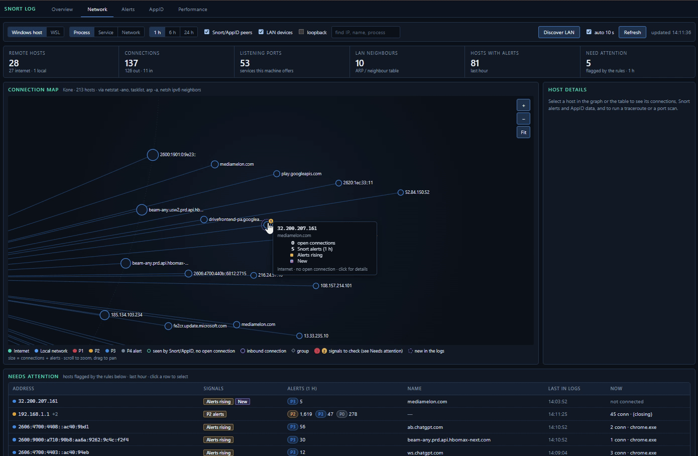
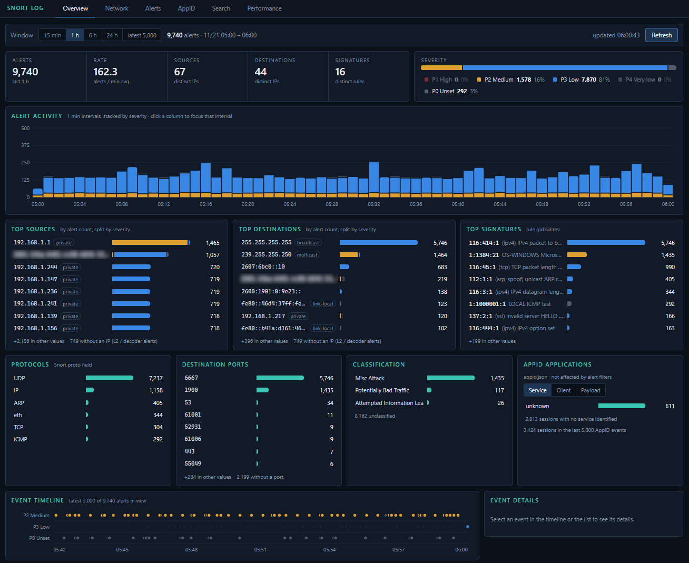
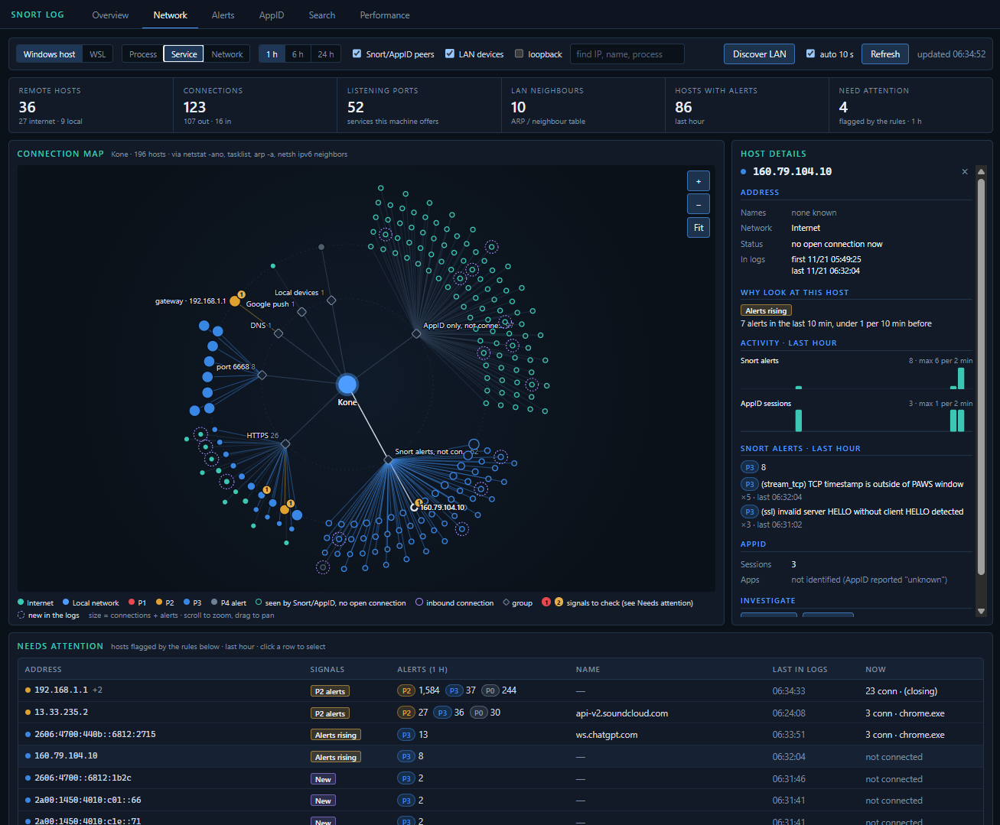
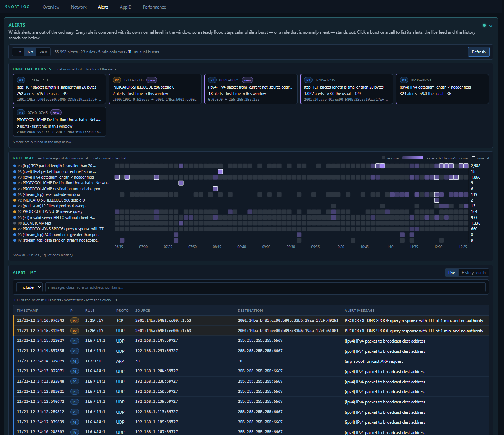
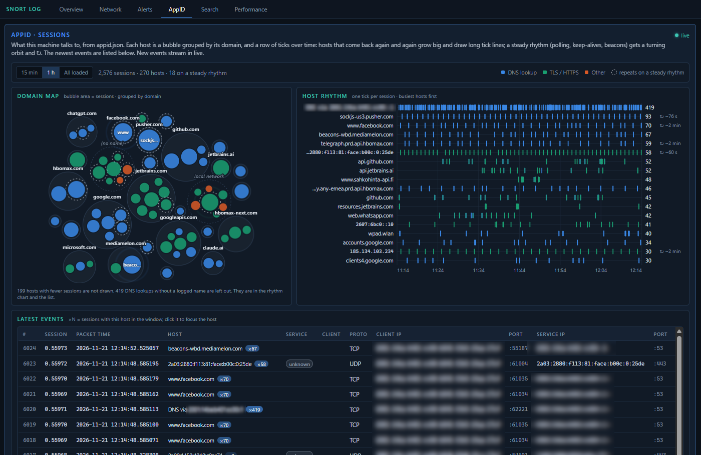
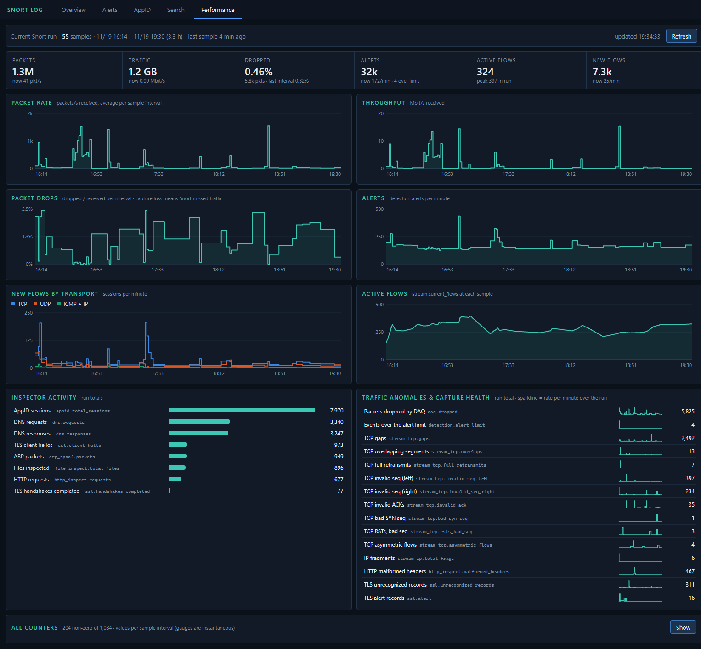

# snort_dashboard: Snort 3 IDS dashboard and log viewer

**A SOC-style web console for Snort 3 intrusion detection. It shows what your network is doing,
which hosts deserve a look and why, and how healthy the sensor itself is, using only the log
files Snort already writes.**

<picture>
  <!-- a still image for readers who prefer reduced motion -->
  <source media="(prefers-reduced-motion: reduce)" srcset="screenshots/l.png">
  
</picture>

Built with React and Node.js/Express for home labs, blue teams and anyone running Snort on Linux
or on Windows through WSL2.

- **No database and no agents.** The server reads Snort's own log files from the end, so even
  months of logs open instantly.
- **Read-only.** It never changes Snort, its configuration or your capture setup, and nothing
  is sent to outside services.
- **Explains instead of scoring.** Hosts are flagged by plain, visible rules (P1/P2 alerts, a
  sudden rise in alerts, inbound connections from the internet, …), each shown with its reason.
- **Works on Linux and Windows.** That includes a Windows PC whose traffic is inspected by Snort
  in WSL2.

The logs it reads:

- `/var/log/snort/alert_json.txt` (`alert_json`)
- `/var/log/snort/appid.json` (`appid_listener` from [snort3_extra](https://github.com/snort3/snort3_extra))
- `/var/log/snort/perf_monitor_base.csv` (`perf_monitor`)

> **Running Snort on Windows?** [ENVIRONMENT.md](ENVIRONMENT.md) is a step-by-step guide to
> monitoring a **Windows host's network traffic** with Snort 3 in **WSL2**. It covers forwarding
> the Windows capture (Npcap/`dumpcap`) to a virtual interface in WSL, the `snort.lua` settings,
> systemd services, starting at logon and the Node.js setup. On a plain Linux machine you only
> need the log outputs from [Snort configuration](#snort-configuration); point Snort at your own
> network interface instead of the WSL-only `snort0`.
>
> **Network tab tools** (nmap, traceroute, tshark, whois, net-tools) and how to set them up on Linux,
> WSL and Windows are covered in [NETWORK.md](NETWORK.md).

## Contents

- [Features](#features)
  - [Overview: the security picture at a glance](#overview-the-security-picture-at-a-glance)
  - [Network: who your computer talks to, and which hosts need a look](#network-who-your-computer-talks-to-and-which-hosts-need-a-look)
  - [Alerts: which alerts are out of the ordinary](#alerts-which-alerts-are-out-of-the-ordinary)
  - [AppID: what applications are on the wire](#appid-what-applications-are-on-the-wire)
  - [Performance: is the sensor keeping up?](#performance-is-the-sensor-keeping-up)
- [Requirements](#requirements)
- [Snort configuration](#snort-configuration)
- [Install](#install)
- [Start](#start)
  - [Configuration](#configuration)
- [API](#api)
- [Tests](#tests)
- [License](#license)

## Features

### Overview: the security picture at a glance



Pick a time window (15 min, 1 h, 6 h, 24 h or the latest 5,000 alerts) to see:

- alert volume and rate over time, stacked by severity, and the share of each severity
- top source and destination IPs, top signatures, protocols, destination ports and
  classifications
- the AppID application mix
- an event timeline and a recent-events list

Click any bar, severity or time column and **every chart filters to it**. An event opens a
details panel with its addresses, ports, protocol, rule (gid:sid:rev) and a ready-made
**Wireshark filter**.

### Network: who your computer talks to, and which hosts need a look



- **Connection map.** Your machine sits in the centre. Around it is every host it is connected
  to, plus every host Snort or AppID saw it talk to. Hosts are grouped by process, service or
  network and coloured by their most severe Snort alert.
- **Needs attention.** Hosts that match a rule (P1/P2 alerts, alerts rising, inbound from the
  internet, service on an unexpected port, new, uncommon remote port) get a badge and are
  listed with their reasons, over a 1 h, 6 h or 24 h window of the logs.
- **Host details.**
  - why the host was flagged
  - alert and AppID activity over time
  - open connections and the processes behind them
  - alert signatures and names (TLS SNI, HTTP Host, reverse DNS, DNS answers seen by tshark)
  - who owns an internet address: holder, country and address block (`whois`), and the AS
  - one-click **traceroute**, and an **nmap** port scan for devices on your own network
- **One device, one node.** The IPv4, IPv6 and link-local addresses of a device (for example
  your router) are recognised by their MAC address and shown as one host.

Details and setup: [NETWORK.md](NETWORK.md).

### Alerts: which alerts are out of the ordinary



Every rule is compared with **its own normal level** in the window (1 h, 6 h or 24 h). A rule
that floods steadily stays calm. A sudden burst stands out, and so does a rule that is normally
silent.

- **Unusual bursts.** The most unusual periods first, each with its count against the rule's usual
  level (for example *752 alerts · ×15 the usual ~49*), the main source → destination, and a
  **new** tag when the rule had not fired earlier in the window. A P1 or P2 rule that is otherwise
  silent ranks high even with a single alert.
- **Rule map.** One row per rule and one column per time slice (1, 5 or 20 minutes). Gray means
  the rule's normal activity. Purple grows stronger from 2 to 32 times its normal level, and
  unusual cells are outlined. Hover a cell for its count and top sources.
- **Alert list.** Click a burst or a cell to list exactly those alerts. The list also has:
  - **Live**: the newest 100 alerts, refreshed every 5 seconds. While an alert's details are open
    the feed pauses so the row doesn't jump away, and a counter shows how many new alerts are
    waiting.
  - **History search**: load the latest N alerts and narrow them down by time range. Sort by any
    column, or put the **rarest** rules first.

A text filter (include or exclude, matching message, classification, rule or address) works in
every list. Click a row for every field and a ready-made **Wireshark filter** built from the
packet timestamp.

Counting happens on the server, so the browser receives a small summary even for 24 hours of
alerts on a busy network.

### AppID: what applications are on the wire



Every session Snort's application identification sees, drawn so that repeating hosts stand out:

- **Domain map.** One bubble per host (TLS SNI, HTTP Host or DNS name), sized by its number of
  sessions and packed into one cluster per domain. Unnamed addresses join the domain seen on the
  same network, or the *local network* group. Hosts that just had a session pulse.
- **Host rhythm.** The busiest hosts, one tick per session on a shared time axis, coloured by
  DNS lookup, TLS or other. A host that keeps coming back draws a long dotted line; a steady
  rhythm (polling, keep-alives, beacons) is detected, marked with ↻ and its period, and gets a
  turning orbit in the map.
- **Latest events.** The raw sessions, each with its host and a ×N counter of how often that
  host appears in the window. Click a host anywhere to focus all three on it.

Choose 15 min, 1 h or everything loaded. Recent sessions are shown as soon as the tab opens, and
new ones appear the moment Snort writes them (pushed over socket.io, no polling). Unidentified
services are highlighted.

### Performance: is the sensor keeping up?



The health of the current Snort run from `perf_monitor`:

- packet rate, throughput and **dropped packets** (capture loss means Snort missed traffic)
- alerts, new and active flows
- inspector activity, and traffic anomalies such as TCP gaps and malformed headers
- all raw counters, one click away

Choose 1 h … 30 d or the whole run. Long ranges are averaged on the server, so a run of months
still draws useful graphs.

---

Severity follows the Snort priority: **P1 high**, **P2 medium**, **P3 low**, **P4 very low**.
**P0** means the rule sets no priority. The colours are the same in every view.

## Requirements

- Snort 3 with `alert_json`, `perf_monitor` and `appid`, and `appid_listener` from snort3_extra
- Node.js 18 or newer (tested with 22). On WSL, use a Linux Node such as nvm, not the Windows
  one. See [ENVIRONMENT.md § 11](ENVIRONMENT.md#11-nodejs-environment-for-snort_dashboard).
- Optional, for the Network tab: nmap, traceroute, tshark and whois (see [NETWORK.md](NETWORK.md))

## Snort configuration

Add the following to `snort.lua`:

```lua
perf_monitor = { }

alert_json =
{
    file = true,
    limit = 100,
    fields = 'timestamp iface src_addr src_port dst_addr dst_port proto action msg priority class sid dir dst_ap eth_dst eth_len eth_src eth_type gid icmp_code ip_id ip_len mpls pkt_gen pkt_len pkt_num rev rule seconds service src_ap target tcp_ack tcp_flags tcp_len tcp_seq tcp_win tos ttl udp_len vlan'
}
-- only timestamp, priority, rule, proto, src_ap, dst_ap, msg, class and seconds are mandatory

appid = { }

appid_listener =
{
    json_logging = true,
    file = '/var/log/snort/appid.json',
}
```

Two options cannot be set in `snort.lua` and must go on the command line:

```bash
snort -c /usr/local/etc/snort/snort.lua \
      -l /var/log/snort \
      --plugin-path /usr/local/lib/snort/plugins/extra
```

- `-l /var/log/snort` puts the log files where the server looks for them.
- `--plugin-path` loads `appid_listener`. Without it the plugin is silently missing.

The full, tested configuration is in [`snort/snort.lua`](snort/snort.lua) and explained in
[ENVIRONMENT.md § 5](ENVIRONMENT.md#5-configure-snortlua). It is written for the WSL setup: its
`daq` block reads the virtual interface `snort0`. On plain Linux, replace `snort0` with your
own interface (for example `eth0`), or remove the `daq` block and pass `-i <interface>`.

## Install

```bash
git clone https://github.com/juhaj77/snort_dashboard.git
cd snort_dashboard
cd server && npm install
cd ../client && npm install
```

## Start

```bash
# server: REST API on :9000, AppID socket on :3009
cd server
sudo env "PATH=$PATH" npm start

# client: development server on :3000
cd client
npm start
```

Open <http://localhost:3000>.

- The server runs with `sudo` because Snort writes `alert_json.txt` readable by root only. Root
  also lets the Network tab see the process behind every connection. `env "PATH=$PATH"` lets
  `sudo` find a Node installed with nvm.
- Start the server with `npm start`, not `node app.js`. Only `npm start` opens the REST API on
  port 9000, which all tabs need.
- Restart the server after updating the code.
- The API has no authentication. Keep ports 9000 and 3009 reachable only from your own machine
  or a trusted network.

### Configuration

| Variable | Where | Default |
|---|---|---|
| `PORT` | server: REST API port | `9000` |
| `NET_CAPTURE_IFACE` | server: interface tshark reads for hostnames (Network tab) | `snort0`, else the default-route interface |
| `SNORT_CONF_DIR` | server: where `local_net.lua` / `snort.lua` are read for `HOME_NET` (Network tab) | `/usr/local/etc/snort` |
| `REACT_APP_API` | client: REST API URL | `http://<page host>:9000` |
| `REACT_APP_SOCKET` | client: AppID socket URL | `ws://<page host>:3009` |

## API

All endpoints return JSON. Log files are read from the end, so large logs don't slow them down.

| Endpoint | Returns |
|---|---|
| `GET /alerts` | the newest 100 alerts |
| `GET /alerts_all/:amount` | the newest `amount` alerts (max 200,000) |
| `GET /alerts_all/:amount?since=<epoch s>` | alerts with `seconds >= since`, at most the newest `amount` |
| `GET /alerts_all/:amount?since=<s>&until=<s>&rule=<gid:sid:rev>` | alerts in `[since, until]`, optionally of one rule, at most the newest `amount` |
| `GET /alerts_stats?since=<s>&until=<s>&step=<s>` | alert counts per rule and time slice of `step` seconds (max 7 days, 500 slices), with the top sources and destinations of each slice |
| `GET /appid/:amount` | the newest `amount` AppID events from `appid.json` |
| `GET /perf` | `perf_monitor_base.csv` rows of the current Snort run, header first |
| `GET /perf?since=<epoch s>&points=<n>` | rows of the current run from `since` (`0` = whole run), folded into at most `n` (default 600) samples: counters summed, gauges newest; with run start and end |
| `GET /network…` | connection snapshot, per-address alert/AppID history, traceroute, nmap scan, LAN discovery, reverse DNS, whois; see [NETWORK.md § API](NETWORK.md#api) |
| socket.io `:3009`, event `json` | each new `appid.json` line as it is written |

Malformed or half-written log lines are skipped.

## Tests

```bash
cd client && npm test   # UI and data model
cd server && npm test   # log readers and tool output parsers
```

## License

[GPL-3.0](LICENSE)
