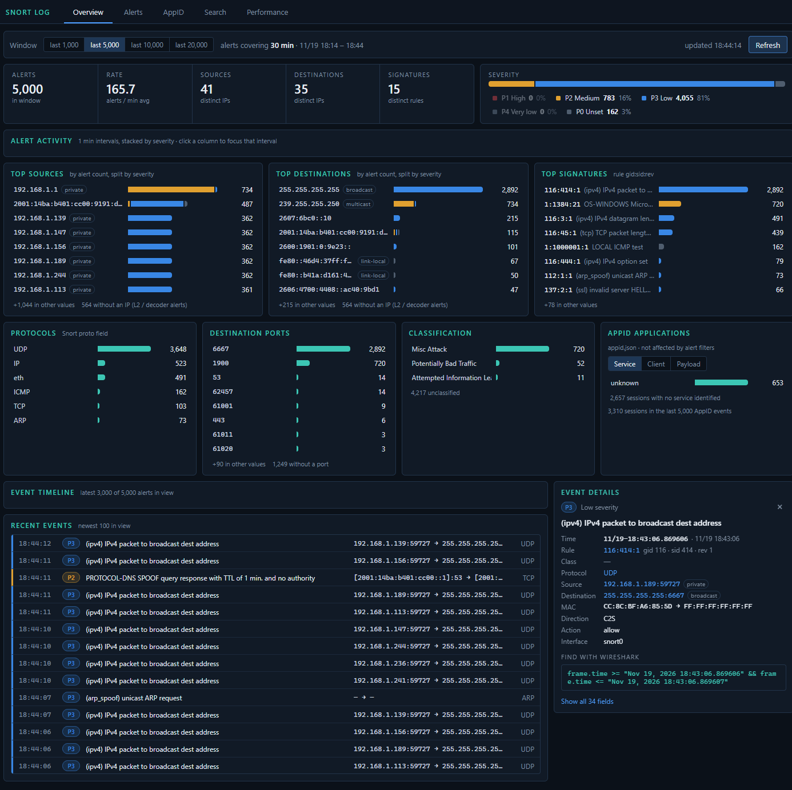
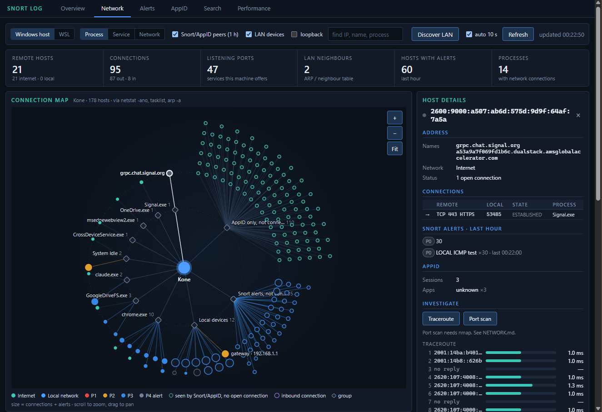
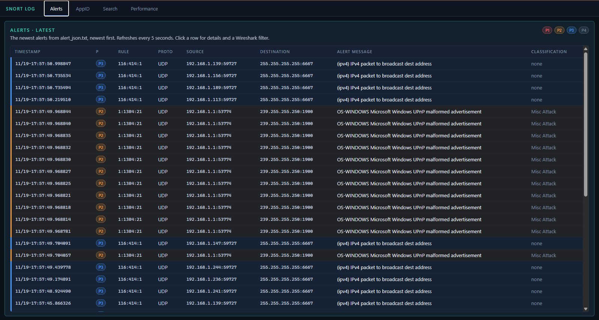
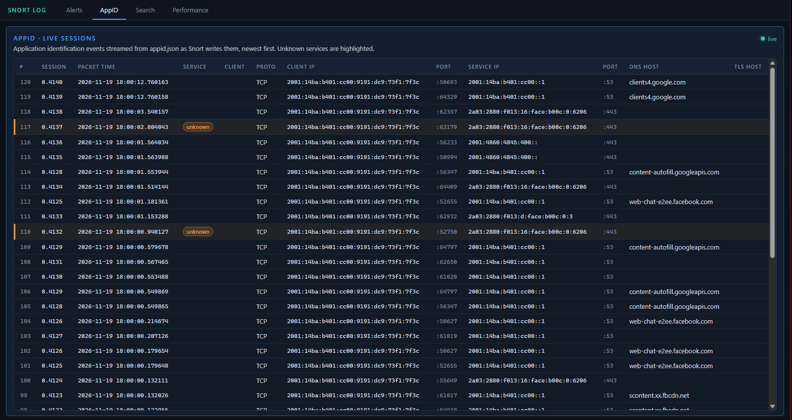
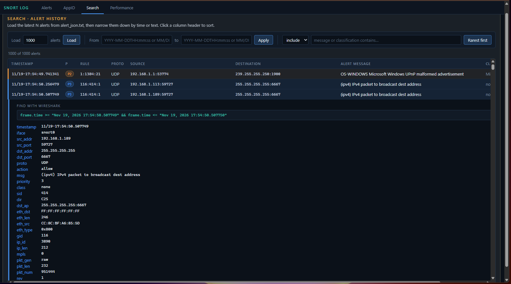
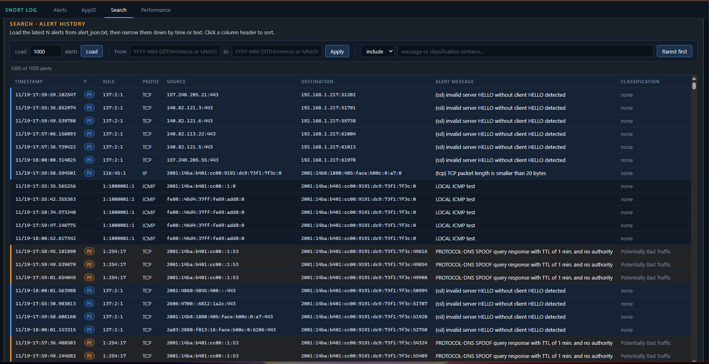

# snort_dashboard: Snort 3 IDS dashboard and log viewer

**A web UI for Snort 3 intrusion detection (IDS) logs: a SOC-style network security overview
dashboard plus views for alerts, AppID sessions, alert search and performance counters.**
Built with React and Node.js/Express for home labs, blue teams and anyone running Snort on
Linux or on Windows through WSL2.

The server reads Snort's log files directly. No database is needed:

- `/var/log/snort/alert_json.txt` (`alert_json`)
- `/var/log/snort/appid.json` (`appid_listener` from [snort3_extra](https://github.com/snort3/snort3_extra))
- `/var/log/snort/perf_monitor_base.csv` (`perf_monitor`)

> **Running Snort on Windows?** [ENVIRONMENT.md](ENVIRONMENT.md) is a step-by-step guide
> for monitoring a **Windows host's network traffic** with Snort 3 running in **WSL2**. It
> covers forwarding the Windows capture (Npcap/`dumpcap`) to a virtual interface in WSL,
> the `snort.lua` settings, systemd services, starting at logon and the Node.js setup.
> The same `snort.lua` settings apply on a plain Linux machine.
>
> **Network tab tools** (nmap, traceroute, tshark, net-tools) and their setup on Linux, WSL and
> Windows are described in [NETWORK.md](NETWORK.md).

## Features

| Tab | What it shows |
|---|---|
| **Overview** | Security dashboard for a time window (15 min, 1 h, 6 h, 24 h or the latest 5,000 alerts). It shows alert activity over time stacked by severity, the share of each severity, top source and destination IPs, top signatures, protocols, destination ports, classifications and the AppID application mix. An event timeline and a recent-events list open a details panel with addresses, ports, protocol, rule (gid:sid:rev) and a Wireshark filter. Clicking a bar, a severity or a time column filters every chart. |
| **Network** | Live connection map in the style of a SOC console: this computer in the centre, every host it talks to around it, grouped by process, service or network and coloured by Snort alert severity. Hosts that match a simple rule (P1/P2 alerts, rising alerts, inbound from the internet, service on an unexpected port, new) get a badge and are listed under **Needs attention**, each with its reason, over a 1 h / 6 h / 24 h window of the Snort and AppID logs. Select a host to see why it was flagged, its alert and AppID activity over time, its connections, alerts, AppID data and names, and run a **traceroute** or (on your own network) an **nmap** port scan. Works on Linux and Windows, including a Windows host monitored from WSL. See [NETWORK.md](NETWORK.md). |
| **Alerts** | The latest alerts, refreshed every 5 seconds (paused while an alert's details are open). Click a row to see all fields and a **Wireshark filter** built from the packet timestamp. |
| **AppID** | The latest AppID sessions from `appid.json` as soon as the tab opens; new ones stream in live over a socket connection. |
| **Search** | Load the latest N alerts, filter them by time range or by text (include or exclude), sort by any column, or sort by rarity. |
| **Performance** | Health of the current Snort run from `perf_monitor` over a chosen time range (1 h … 30 d or the whole run; long ranges are averaged on the server): packet rate, throughput, dropped packets, alerts, flows, inspector activity and traffic anomalies over time. All raw counters are one click away. |

Severity follows the Snort priority: **P1 high**, **P2 medium**, **P3 low**, **P4 very low**.
**P0** means the rule sets no priority. The colours are the same in every view.

## Requirements

- Snort 3 with `alert_json`, `perf_monitor` and `appid`, and `appid_listener` from snort3_extra
- Node.js 18 or newer (tested with 22). On WSL, use a Linux Node such as nvm, not the
  Windows one. See [ENVIRONMENT.md § 11](ENVIRONMENT.md#11-nodejs-environment-for-snort_log_view).

## Snort configuration

Add the following to `snort.lua`:

```lua
perf_monitor = { }

alert_json =
{
    file = true,
    limit = 100,
    fields = 'timestamp iface src_addr src_port dst_addr dst_port proto action msg priority class sid dir dst_ap eth_dst eth_len eth_src eth_type gid icmp_code ip_id ip_len mpls pkt_gen pkt_len pkt_num rev rule seconds service src_ap target tcp_ack tcp_flags tcp_len tcp_seq tcp_win tos ttl udp_len vlan'
}
-- only timestamp, priority, rule, proto, src_ap, dst_ap, msg, class and seconds are mandatory

appid = { }

appid_listener =
{
    json_logging = true,
    file = '/var/log/snort/appid.json',
}
```

Two options cannot be set in `snort.lua` and must go on the command line:

```bash
snort -c /usr/local/etc/snort/snort.lua \
      -l /var/log/snort \
      --plugin-path /usr/local/lib/snort/plugins/extra
```

- `-l /var/log/snort` puts the log files where the server looks for them.
- `--plugin-path` loads `appid_listener`. Without it the plugin is silently missing.

The full, tested configuration (including the live-interface settings) is in
[`snort/snort.lua`](snort/snort.lua) and explained in [ENVIRONMENT.md § 5](ENVIRONMENT.md#5-configure-snortlua).

## Install

```bash
cd server && npm install
cd ../client && npm install
```

## Start

```bash
# server: REST API on :9000, AppID socket on :3009
cd server
sudo env "PATH=$PATH" npm start

# client: development server on :3000
cd client
npm start
```

Open <http://localhost:3000>.

- The server runs with `sudo` because Snort writes `alert_json.txt` readable by root only.
  `env "PATH=$PATH"` lets `sudo` find a Node installed with nvm.
- Start the server with `npm start`, not `node app.js`. Only `npm start` opens the REST API
  on port 9000, which the Overview, Alerts, Search and Performance tabs need.
- Restart the server after updating the code.

### Configuration

| Variable | Where | Default |
|---|---|---|
| `PORT` | server: REST API port | `9000` |
| `NET_CAPTURE_IFACE` | server: interface tshark reads for hostnames (Network tab) | `snort0`, else the default-route interface |
| `REACT_APP_API` | client: REST API URL | `http://<page host>:9000` |
| `REACT_APP_SOCKET` | client: AppID socket URL | `ws://<page host>:3009` |

## API

All endpoints return JSON. Log files are read from the end, so large logs don't slow them down.

| Endpoint | Returns |
|---|---|
| `GET /alerts` | the newest 38 alerts |
| `GET /alerts_all/:amount` | the newest `amount` alerts (max 200,000) |
| `GET /alerts_all/:amount?since=<epoch s>` | alerts with `seconds >= since`, at most the newest `amount` |
| `GET /appid/:amount` | the newest `amount` AppID events from `appid.json` |
| `GET /perf` | `perf_monitor_base.csv` rows of the current Snort run, header first |
| `GET /perf?since=<epoch s>&points=<n>` | rows of the current run from `since` (`0` = whole run), folded into at most `n` (default 600) samples: counters summed, gauges newest; with run start and end |
| `GET /network…` | connection snapshot, per-address alert/AppID history, traceroute, nmap scan, LAN discovery, reverse DNS; see [NETWORK.md § API](NETWORK.md#api) |
| socket.io `:3009`, event `json` | each new `appid.json` line as it is written |

Malformed or half-written log lines are skipped.

## Tests

```bash
cd client && npm test   # UI and data model
cd server && npm test   # tool output parsers
```

## Screenshots

The overview view

The Network view shows the current network connections

The alert view shows the latest alerts

The AppID view is updated over a socket connection

The search tab has various search and sorting features


Performance dashboard


## License

[GPL-3.0](LICENSE)
